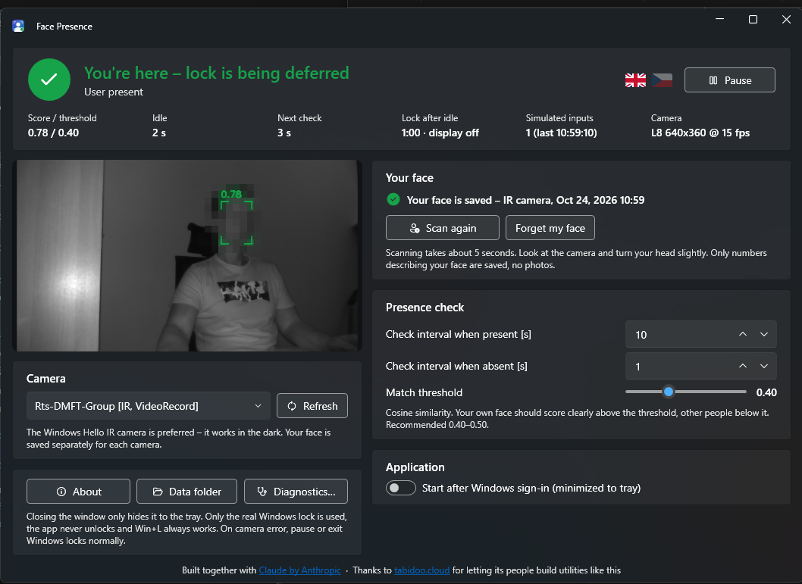

<p align="center"></p>

<h1 align="center">Face Presence</h1>

<p align="center">
Keeps Windows unlocked while <b>you</b> sit in front of the camera, and lets it lock normally when you leave.<br>
Local face recognition, Windows Hello IR camera supported, one EXE with nothing to install, no cloud.
</p>

<p align="center"><a href="README.cs.md">Česky</a></p>

<p align="center"></p>

---

## Why

Short idle lock timeouts are good security, but annoying when you are reading, thinking or on a call without touching
the keyboard. "Mouse jiggler" tools fix the annoyance by removing the security: the PC stays unlocked even when you walk
away. Face Presence defers the lock **only while it recognizes your face**. When you leave, Windows locks exactly as
configured.

## Features

- **Recognizes you, not just any face.** You scan your face once; other people in front of the camera do not keep the PC unlocked.
- **Windows Hello IR camera preferred.** Works in the dark and is harder to fool with a picture on a screen. A regular
  webcam is used when no IR camera is available.
- **Runs locally.** Face detection (YuNet) and recognition (SFace) run on your CPU via OpenCV. Nothing is uploaded.
- **Adaptive checks.** Every 10 s while you are recognized, every 1 s while you are not (both configurable).
- **Uses the real Windows lock.** No custom lock screen, never unlocks anything, Win+L always works.
- **Shows when Windows would lock** – it reads the inactivity policy, secure screen saver, display-off and sleep
  settings and counts down while you are away.
- Windows 11 look (Fluent, Mica, light and dark mode follow the system), tray icon with state colors, live preview
  with match score, built-in diagnostics, English and Czech UI, start after sign-in.

## How it works

1. A camera frame is grabbed through the WinRT `MediaFrameReader` (the only API that exposes the Windows Hello IR
   camera; DirectShow / OpenCV `VideoCapture` cannot see it). For IR cameras only illuminated frames are used.
2. YuNet finds the largest face, the face is aligned to 112×112 and SFace turns it into a 128-dimensional embedding.
3. The embedding is compared (cosine similarity) with your saved face from the same camera.
4. While you are recognized the app:
   - holds `SetThreadExecutionState(ES_DISPLAY_REQUIRED)` – keeps the display on and prevents sleep, and
   - reads the real idle time with `GetLastInputInfo`; only when you have not touched the keyboard or mouse for a while
     (40 s by default, at most 60 % of the detected lock timeout) **and** your face was just verified, it sends a single
     zero-distance mouse move with `SendInput`. The cursor does not move, but Windows counts it as activity. This is the
     only way to defer the *Interactive logon: Machine inactivity limit* policy, which ignores everything except input.
5. When you leave, the camera fails, you pause the app, the session locks or the app exits, all of this stops and
   Windows locks on its own schedule. On lock the camera is released so Windows Hello can use it.

## Requirements

- Windows 11 or Windows 10 (version 2004 / build 19041 or newer), x64
- A camera; a Windows Hello IR camera is recommended
- Camera access for desktop apps allowed in *Settings → Privacy & security → Camera*

## Getting started

1. Download `FacePresence-<version>-win-x64.exe` from [Releases](../../releases) and run it. It is a single file with
   everything inside – no installation, no .NET to install. The first start takes a few seconds while it unpacks.
2. The IR camera is selected automatically when present. Click **Scan my face** and look at the camera for about 5 s.
3. Watch the score in the preview: your face should be clearly above the threshold (0.40 by default). If someone
   else gets close to it, raise the threshold to 0.45–0.50.
4. Optionally tick **Start after Windows sign-in**.
5. **Diagnostics…** verifies on your machine that the IR camera delivers frames, that the simulated input resets the
   idle timer, and which lock policies apply.

Closing the window only hides it to the tray. Run the EXE again or double-click the tray icon to bring it back.

## Security and privacy

- Face Presence never changes system security policies and never unlocks Windows. It can only *defer* an automatic
  idle lock while you are recognized.
- **There is no liveness detection.** A good enough image of your face in front of the camera can keep the PC
  unlocked. The IR camera makes this harder, not impossible. Do not use Face Presence where that risk is not acceptable.
- Your face is stored as numeric face embeddings (no photos) in `%LOCALAPPDATA%\FacePresence\settings.json`,
  unencrypted, readable by your Windows account. Nothing is sent anywhere.
- On managed devices the idle lock is usually a company policy. Make sure your organization allows tools like this.

## Known limitations

- *Dynamic Lock* (lock when your Bluetooth phone leaves) and third-party idle-lock agents work independently and are
  not deferred.
- `SendInput` is blocked by Windows when an elevated window (UAC prompt, admin app) has focus.
- The recognition model was trained on color photos; on IR images it works well when you scan your face on the same camera,
  but the scores are lower than on a color camera.

## Building

```
dotnet build src/FacePresence/FacePresence.csproj -c Release
pwsh build/windows/build.ps1 -Version 0.1.0     # -> out/FacePresence-0.1.0-win-x64.exe
```

The build also works on Linux/macOS (`EnableWindowsTargeting`), running requires Windows. `build.ps1` signs the EXE
with Azure Artifact Signing when the `ARTIFACT_SIGNING_*` and `AZURE_*` environment variables are set; without them the
EXE is unsigned. GitHub Actions build every push (`build.yml`) and publish a release for every `v*` tag (`release.yml`);
the release job reads the signing secrets from the `release` environment.

Project layout: `Capture/` camera access, `Recognition/` face engine, `Presence/` monitoring loop, idle handling and
lock policy detection, `UI/` WPF windows (WPF UI Fluent controls), `Localization/` texts, `Diagnostics/` the self-test.

## License

MIT – see [LICENSE](LICENSE). Bundled components (OpenCV, OpenCvSharp, the YuNet and SFace models and the libraries
statically linked into OpenCV) keep their own licenses, listed with full texts in
[THIRD-PARTY-NOTICES.txt](THIRD-PARTY-NOTICES.txt) and in the app under *About*.

## Acknowledgements

Built together with [Claude](https://claude.ai) by Anthropic. Thanks to [tabidoo.cloud](https://tabidoo.cloud) for
letting its people build utilities like this.
